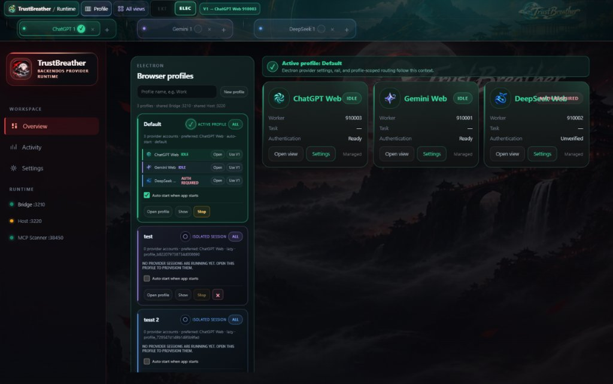
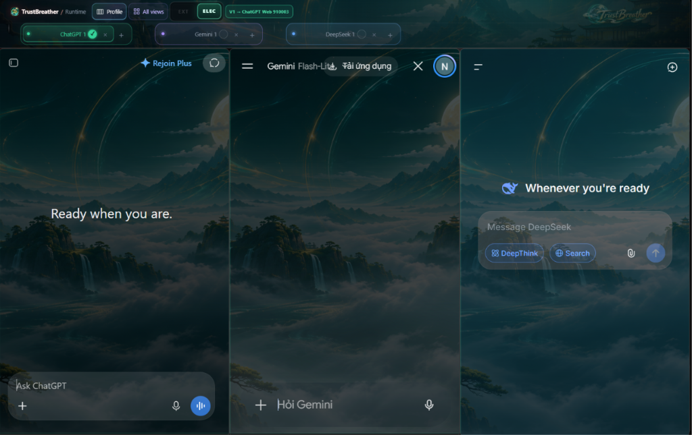

<div align="center">



<h1>Backend OS</h1>

<p><strong>Local orchestration kernel for OpenAI-compatible clients</strong></p>

<p>Kết nối các AI client và công cụ lập trình với các mô hình AI web qua chuẩn API tương thích và giao thức MCP.</p>

<p>
  
  
  
</p>

<p><strong>Client gửi yêu cầu. Backend OS điều phối. Phản hồi stream theo thời gian thực.</strong></p>

</div>

<br>



<br>

<table align="center">
  <tr>
    <td align="center" width="33%"><strong>CLIENT HARNESS</strong><br><sub>Cursor, Continue, Cline, Open Interpreter...</sub></td>
    <td align="center" width="33%"><strong>BACKEND OS</strong><br><sub>Điều phối & chuẩn hóa luồng dữ liệu</sub></td>
    <td align="center" width="33%"><strong>AI PROVIDERS</strong><br><sub>ChatGPT, Gemini, DeepSeek Web</sub></td>
  </tr>
</table>

## Backend OS là gì?

Backend OS là giải pháp **Local Orchestration** chạy trên máy cá nhân, cho phép kết nối trực tiếp các công cụ lập trình và AI client ưa thích của bạn với các nền tảng AI phổ biến theo chuẩn OpenAI API và giao thức MCP.

Mô hình hoạt động tổng quan:

```text
Client (Cursor, Continue, Cline, API...)
  ├─ OpenAI API (/v1/chat/completions)
  └─ MCP Protocol (/mcp/sse)
          ↓
Backend OS
  ├─ Tiếp nhận và điều phối yêu cầu
  └─ Stream kết quả về client theo thời gian thực
          ↓
AI Providers
  ├─ ChatGPT Web
  ├─ Gemini Web
  └─ DeepSeek Web
```

## Giao diện Quản trị & Điều phối

Backend OS sở hữu giao diện điều khiển trực quan, giúp người dùng dễ dàng quản lý phiên làm việc, chuyển đổi tài khoản và giám sát trạng thái của các mô hình AI.

### 1. Trung tâm Quản trị Profile & Provider (Dashboard)

<div align="center">
  
  <p><em>Giao diện quản lý Profiles, trạng thái kết nối và các AI Provider (ChatGPT, Gemini, DeepSeek).</em></p>
</div>

Các tính năng nổi bật:
- **Quản lý Profile độc lập**: Tạo và quản lý nhiều Profile (`Default`, `Work`, `Personal`...) với không gian làm việc tách biệt hoàn toàn, thuận tiện cho việc sử dụng nhiều tài khoản.
- **Theo dõi trạng thái Provider trực quan**:
  - Nhận biết nhanh tình trạng của từng nhà cung cấp (Sẵn sàng / Đang bận / Cần đăng nhập).
  - Hỗ trợ đa dạng nền tảng: ChatGPT, Gemini (Flash, Pro), DeepSeek.
- **Giám sát kết nối hệ thống**: Hiển thị trạng thái hoạt động tức thời của các dịch vụ điều phối và giao thức MCP.
- **Thao tác nhanh**: Hỗ trợ mở giao diện làm việc, tùy chỉnh cài đặt và bật tính năng tự động khởi chạy khi mở ứng dụng.

### 2. Chế độ Giám sát Đồng thời (All Views)

<div align="center">
  
  <p><em>Chế độ All Views hiển thị đồng thời các giao diện ChatGPT, Gemini và DeepSeek trên cùng một màn hình.</em></p>
</div>

Ưu điểm của chế độ All Views:
- **Quan sát song song nhiều nhà cung cấp**: Hiển thị trực quan giao diện của các mô hình AI trên một màn hình chia cột đồng nhất.
- **Theo dõi luồng phản hồi trực tiếp**: Dễ dàng quan sát tiến trình sinh nội dung của từng mô hình theo thời gian thực.
- **Kiểm tra và tương tác tiện lợi**: Cho phép tương tác hoặc đăng nhập tài khoản trực tiếp ngay trên từng cửa sổ mà không cần mở trình duyệt rời.

## Cài đặt bản phát hành Windows

<details>
<summary><strong>Mở hướng dẫn cài đặt</strong></summary>

Sau khi khởi chạy, Backend OS mặc định lắng nghe tại `http://127.0.0.1:3210`.

### 1. Chuẩn bị các file

Tải đầy đủ các file dưới đây về **cùng một thư mục**:

```text
Backend-OS/
├─ manifest.json
├─ gpt_agent.exe.part001
├─ gpt_agent.exe.part002
├─ merge.bat
├─ get_hdid.exe
└─ ...
```

`manifest.json` là nguồn thông tin cho tên file output, thứ tự các part và SHA-256 cần kiểm tra.

### 2. Ghép executable

Double-click:

```text
merge.bat
```

Script sẽ ghép các part thành:

```text
gpt_agent.exe
```

Sau khi ghép, script tự tính SHA-256 của file output và dừng nếu không khớp với `manifest.json`.

### 3. Lấy HDID và đặt license

1. Double-click `get_hdid.exe`.
2. Copy HDID hiển thị trong cửa sổ.
3. Gửi HDID cho nhà cung cấp để nhận license `.json`.
4. Đặt file license cạnh executable:

```text
gpt_agent.exe
license.json
```

### 4. Khởi chạy

Double-click `gpt_agent.exe` sau khi license đã được đặt đúng vị trí.

</details>

## Cấu hình kết nối AI Client

Backend OS cung cấp endpoint tương thích chuẩn OpenAI API. Bạn có thể kết nối ngay với các công cụ lập trình yêu thích (Cursor, Continue, Cline, Open Interpreter...):

| Thông số | Giá trị cấu hình |
| :--- | :--- |
| **API Type** | `OpenAI Compatible` |
| **Base URL** | `http://127.0.0.1:3210/v1` |
| **API Key** | `sk-backendos` *(hoặc chuỗi ký tự bất kỳ)* |
| **Model ID** | `chatgpt`, `gemini`, `deepseek` |
| **Stream** | `true` *(hỗ trợ native SSE streaming)* |

## Các file chính

| File | Vai trò |
| --- | --- |
| `manifest.json` | Mô tả artifact, thứ tự part và các giá trị SHA-256. |
| `gpt_agent.exe.part*` | Các phần được chia nhỏ của executable. |
| `merge.bat` | Lệnh Windows để ghép và xác thực executable. |
| `merge.ps1` | Wrapper PowerShell cho thao tác ghép file. |
| `get_hdid.exe` | Công cụ lấy HDID của máy. |
| `license.json` | License do nhà cung cấp cấp, đặt cạnh executable. |
| `assets/` | Thư mục chứa tài nguyên đồ họa (banner, sơ đồ, ảnh giao diện). |

<div align="center">

<br>

<strong>Model in. API out. Client-compatible by design.</strong>

</div>
