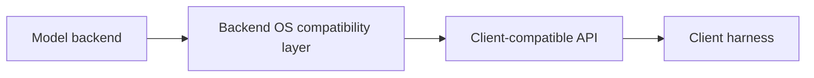

<div align="center">



# Backend OS

### Model-to-API compatibility for client harnesses

Đưa model backend ra qua một API tương thích để các client harness hiện có có thể kết nối mà không cần phụ thuộc trực tiếp vào implementation của model.

<p>
  
  
  
</p>

<p>
  <strong>Model backend vào. API tương thích ra. Client harness tiếp tục hoạt động.</strong>
</p>

</div>

---

## Backend OS là gì?

Backend OS là lớp tương thích nằm giữa **model backend** và **client harness**. Repo đưa model ra qua một API surface mà client đã biết cách gọi, để contract của client được tách khỏi implementation cụ thể phía backend.

Các lớp chính:

<table>
  <tr>
    <td width="50%">
      <h3>Model backend</h3>
      Nơi model thực thi và tạo ra response cho request.
    </td>
    <td width="50%">
      <h3>API compatibility</h3>
      Ánh xạ request, response và error về hình dạng mà client harness mong đợi.
    </td>
  </tr>
  <tr>
    <td width="50%">
      <h3>Client harness</h3>
      Cho phép các client hiện có kết nối qua interface tương thích.
    </td>
    <td width="50%">
      <h3>Adapter boundary</h3>
      Giữ contract phía client tách khỏi implementation của model backend.
    </td>
  </tr>
</table>

### Luồng hoạt động



> **Compatibility by design:** client gọi vào API contract; implementation cụ thể của model nằm phía sau lớp tương thích.

---

## Cài đặt bản phát hành Windows

### 1. Chuẩn bị các file

Tải đầy đủ các file dưới đây về **cùng một thư mục**:

```text
Backend-OS/
├─ manifest.json
├─ gpt_agent.exe.part001
├─ gpt_agent.exe.part002
├─ merge.bat
├─ get_hdid.exe
└─ ...
```

`manifest.json` là nguồn thông tin cho tên file output, thứ tự các part và SHA-256 cần kiểm tra.

### 2. Ghép executable

Double-click:

```text
merge.bat
```

Script sẽ ghép các part thành:

```text
gpt_agent.exe
```

Sau khi ghép, script tự tính SHA-256 của file output và dừng nếu không khớp với `manifest.json`.

### 3. Lấy HDID và đặt license

1. Double-click `get_hdid.exe`.
2. Copy HDID hiển thị trong cửa sổ.
3. Gửi HDID cho nhà cung cấp để nhận license `.json`.
4. Đặt file license cạnh executable:

```text
gpt_agent.exe
license.json
```

### 4. Khởi chạy

Double-click `gpt_agent.exe` sau khi license đã được đặt đúng vị trí.

---

## Các file chính

| File | Vai trò |
| --- | --- |
| `manifest.json` | Mô tả artifact, thứ tự part và các giá trị SHA-256. |
| `gpt_agent.exe.part*` | Các phần được chia nhỏ của executable. |
| `merge.bat` | Lệnh Windows để ghép và xác thực executable. |
| `merge.ps1` | Wrapper PowerShell cho thao tác ghép file. |
| `get_hdid.exe` | Công cụ lấy HDID của máy. |
| `license.json` | License do nhà cung cấp cấp, đặt cạnh executable. |

<div align="center">

### Build the workflow. Keep the intent simple.

</div>
