<div align="center">


<h1>Backend OS</h1>

<p><strong>Model-to-API compatibility for client harnesses</strong></p>

<p>Đưa model backend ra qua một API tương thích để các client harness hiện có có thể kết nối mà không cần phụ thuộc trực tiếp vào implementation của model.</p>

<p>
  
  
  
</p>

<p><strong>Model backend vào. API tương thích ra. Client harness tiếp tục hoạt động.</strong></p>

</div>

<br>



<br>

<table align="center">
  <tr>
    <td align="center" width="33%"><strong>MODEL BACKEND</strong><br><sub>Thực thi model và tạo response</sub></td>
    <td align="center" width="33%"><strong>API COMPATIBILITY</strong><br><sub>Ánh xạ request, response và error</sub></td>
    <td align="center" width="33%"><strong>CLIENT HARNESS</strong><br><sub>Kết nối qua client contract</sub></td>
  </tr>
</table>

## Backend OS là gì?

Backend OS là lớp tương thích nằm giữa **model backend** và **client harness**. Client gọi vào API contract; implementation cụ thể của model nằm phía sau lớp adapter.

Mục tiêu của repo là giữ cho hai phía tách biệt:

```text
Client harness  →  Client-compatible API  →  Backend OS adapter  →  Model backend
```

## Cài đặt bản phát hành Windows

<details>
<summary><strong>Mở hướng dẫn cài đặt</strong></summary>

### 1. Chuẩn bị các file

Tải đầy đủ các file dưới đây về **cùng một thư mục**:

```text
Backend-OS/
├─ manifest.json
├─ gpt_agent.exe.part001
├─ gpt_agent.exe.part002
├─ merge.bat
├─ get_hdid.exe
└─ ...
```

`manifest.json` là nguồn thông tin cho tên file output, thứ tự các part và SHA-256 cần kiểm tra.

### 2. Ghép executable

Double-click:

```text
merge.bat
```

Script sẽ ghép các part thành:

```text
gpt_agent.exe
```

Sau khi ghép, script tự tính SHA-256 của file output và dừng nếu không khớp với `manifest.json`.

### 3. Lấy HDID và đặt license

1. Double-click `get_hdid.exe`.
2. Copy HDID hiển thị trong cửa sổ.
3. Gửi HDID cho nhà cung cấp để nhận license `.json`.
4. Đặt file license cạnh executable:

```text
gpt_agent.exe
license.json
```

### 4. Khởi chạy

Double-click `gpt_agent.exe` sau khi license đã được đặt đúng vị trí.

</details>

## Các file chính

| File | Vai trò |
| --- | --- |
| `manifest.json` | Mô tả artifact, thứ tự part và các giá trị SHA-256. |
| `gpt_agent.exe.part*` | Các phần được chia nhỏ của executable. |
| `merge.bat` | Lệnh Windows để ghép và xác thực executable. |
| `merge.ps1` | Wrapper PowerShell cho thao tác ghép file. |
| `get_hdid.exe` | Công cụ lấy HDID của máy. |
| `license.json` | License do nhà cung cấp cấp, đặt cạnh executable. |

<div align="center">

<br>

<strong>Model in. API out. Client-compatible by design.</strong>

</div>
